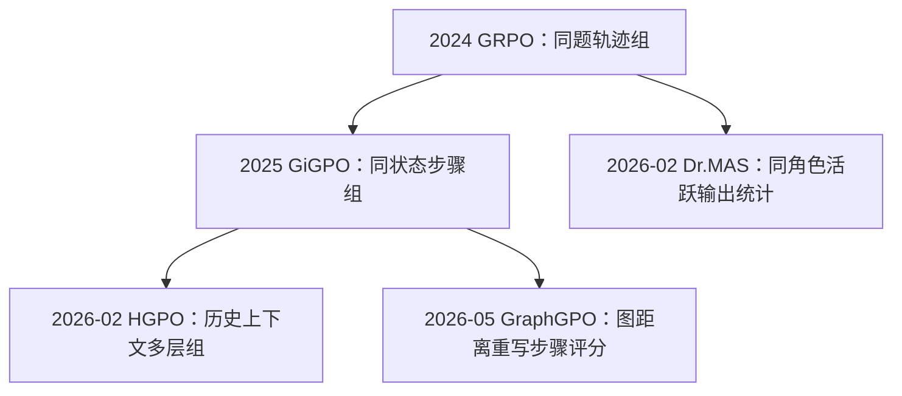

# 从 GRPO 到 GiGPO、Dr.MAS、HGPO、GraphGPO：时间线与分组优势的统一视角

> 整理日期：2026-10-05。时间按 **arXiv v1 首次提交日期** 排列，不按会议召开时间推断研究先后。公式核对本地论文和官方代码；下面的统一表达与教学例子是本文整理，不是各论文共同提出的一条定理。

## 1. 对“它们是一条主线”的判断

这个观察很有价值：**它们都在研究，如何用一组采样得到的经验，为策略更新构造更合适的相对学习信号。**

但“都是把 $N$ 条 trajectory 的 state/action 分组，以突破 trajectory-level advantage”需要细化：

- **GRPO 是起点**：在这里比较的是 outcome-supervision GRPO，按同题完整输出/轨迹比较。原始 DeepSeekMath 也讨论了 process supervision，不能说所有 GRPO 必然只有终局信号。
- **GiGPO → HGPO/GraphGPO** 是多轮步骤信用分配的一条清晰主线：同状态比较 → 历史条件可比性，或同状态比较 → 图结构重新评分。
- **Dr.MAS 是角色条件归一化分支**：仍用同一条协作轨迹的团队最终奖励，按 agent 实际出场实例计算均值/标准差，主要修复不同角色的更新尺度错配。

因此更准确的总标题是 **“group-based advantage 的比较集合、评分来源和归一化方式如何演变”**。step-level credit assignment 是其中的重要分支，而非五篇完全相同的目标。

## 2. 时间线：真正的公开顺序

| arXiv v1 日期 | 方法 | 论文/会议 | 新提出的核心问题 |
|---|---|---|---|
| **2024-02-05** | GRPO | [DeepSeekMath](https://arxiv.org/abs/2402.03300) | 能否用同题输出的组内奖励统计代替 learned critic？ |
| **2025-05-16** | GiGPO | [NeurIPS 2025](https://arxiv.org/abs/2505.10978) | 能否在不额外 rollout 的情况下，用重复状态构造局部比较？ |
| **2026-02-09** | Dr.MAS | [NeurIPS 2026](https://arxiv.org/abs/2602.08847) | 团队奖励共用一套归一化，是否与各角色实际训练样本分布错配？ |
| **2026-02-26** | HGPO | [ICLR 2026](https://arxiv.org/abs/2602.22817) | 当前状态一样，但模型历史输入不同，组内比较是否仍合理？ |
| **2026-05-26** | GraphGPO | [ICML 2026](https://arxiv.org/abs/2605.26684) | 即便已有步骤分组，动作评分是否仍被所在轨迹的后续成败绑死？ |

特别注意：Dr.MAS 的 arXiv 首发早于 HGPO、GraphGPO。不能因为会议是 NeurIPS 2026，就把它写成 GraphGPO 之后的下一代。

概念关系可以画成下面的分支；箭头表示方法问题之间的解释性联系，不是主张作者直接继承关系：



## 3. 先拆开四个经常被混用的概念

固定一道题 $x$，采样 $N$ 条轨迹：

$$
\tau_i=\{(s_{i,t},a_{i,t},r_{i,t},k_{i,t})\}_{t=1}^{T_i}.
$$

$s$ 是状态表示，$a$ 是一次生成输出，$r$ 是即时环境奖励，$k$ 是可选 agent 角色。$N$ 是轨迹数，不是角色数；一条 MAS trajectory 可以包含 Solver、Verifier 等多次协作调用。

| 对象 | 数学形式 | 意义 |
|---|---|---|
| 环境 reward | $r_{i,t}$ | 环境/任务验证器实际给出的反馈 |
| 实际 return-to-go | $G_{i,t}=\sum_{u=t}^{T_i}\gamma^{u-t}r_{i,u}$ | 这条轨迹从当前步骤往后实际获得的回报 |
| 代理评分 | 如 $R^G(s,a,s')$ | 用图等结构重新构造的动作分数 |
| advantage | 评分减 baseline，再可选除尺度 | 决定相对强化/抑制方向的更新信号 |

GiGPO 主要把已有 return 变成局部 advantage；GraphGPO 进一步替换评分；Dr.MAS 在团队终局 reward 不变时改角色 baseline 和尺度。三者的改变位置不同。

## 4. 一个统一“接口”，而不是强行写成同一算法

令 $u=(i,t)$ 表示待更新的动作出现实例。对某一分组规则 $c$，定义比较集合 $\mathcal B_c(u)$、评分 $Z_v$ 和统计权重 $q_{uv}^{(c)}$：

$$
\mu_c(u)=\sum_{v\in\mathcal B_c(u)}q_{uv}^{(c)}Z_v,
\quad
\sigma_c^2(u)=\sum_{v\in\mathcal B_c(u)}q_{uv}^{(c)}(Z_v-\mu_c(u))^2,
\quad \sum_vq_{uv}^{(c)}=1.
$$

集合决定“和谁比”，$q$ 决定“每个轨迹/出现实例算几次”，$Z$ 决定“拿什么比”。标准化后可再融合：

$$
A_u=\sum_c\lambda_c(u)\frac{Z_u^{(c)}-\mu_c(u)}{D_c(u)},
\qquad D_c(u)\in\{1,\sigma_c(u)+\varepsilon\}.
$$

它能描述这些方法的主要差别，但不意味着它们都优化同一个无偏梯度，也不意味着 $\lambda$ 都是概率权重：GiGPO 默认两项直接相加，HGPO 主要是各层加权平均。

## 5. 2024：GRPO——按任务比较整条输出

outcome-supervision GRPO 的公式为：

$$
\mu_x=\frac1N\sum_iR_i,\quad
\sigma_x^2=\frac1N\sum_i(R_i-\mu_x)^2,\quad
A_{i,t}^{\mathrm{GRPO}}=\frac{R_i-\mu_x}{\sigma_x+\varepsilon}.
$$

$R_i$ 是第 $i$ 条完整输出/轨迹的终局质量评分。在扩展到多轮的这个基线中，相同 $i$ 的所有步骤拿到同一个优势。它解决了 critic 成本问题，但未区分某条轨迹内部哪个动作有效。

比较集合是同题 $N$ 条轨迹，不要求共享中间状态，也不需要跨轨迹状态匹配。[原文 §4.1](https://arxiv.org/html/2402.03300v3)。

## 6. 2025：GiGPO——同状态重组比较集合

$$
\mathcal G_x(s)=\{(j,u):s_{j,u}=s\},\qquad
A_{i,t}^S=\frac{G_{i,t}-\mu_{\mathcal G_x(s_{i,t})}}
{D_{\mathcal G_x(s_{i,t})}},
$$

$$
A_{i,t}^{\mathrm{GiGPO}}=A_i^E+\omega A_{i,t}^S.
$$

$G$ 是自身轨迹的实际折扣回报；$A_i^E$ 保留整轨迹相对质量。改变的是比较集合与时间粒度，而不是建立一个新的环境奖励模型。

组内可以跨轨迹、跨时间，也可以包含同一轨迹多次访问同状态。它不按相同 action 聚类，也不要求每个候选动作都不同。一个步骤一个标量，仍广播到这次输出的所有有效 token。

**残留问题**：好动作仍可能被其所在轨迹后面的失败拖累；同状态也可能对应不同历史 prompt。详见 [GiGPO 解读](./credit-assignment/NeurIPS2025-GiGPO/analysis.md)。

## 7. 2026-02-09：Dr.MAS——按角色实际出场分布归一化

对角色 $k$，定义活跃步骤集合及出现次数：

$$
\mathcal Y_{x,k}=\{(i,t):k_{i,t}=k\},\qquad
n_{ik}=\sum_t\mathbf1[k_{i,t}=k],\qquad
M_{x,k}=\sum_in_{ik}.
$$

仍使用同一条协作 trajectory 的最终团队奖励 $R_i$：

$$
\mu_{x,k}=\frac{\sum_i n_{ik}R_i}{M_{x,k}},\qquad
\sigma_{x,k}^2=\frac{\sum_i n_{ik}(R_i-\mu_{x,k})^2}{M_{x,k}},
$$

$$
A_{i,t}^{\mathrm{DrMAS}}=\frac{R_i-\mu_{x,k_{i,t}}}{\sigma_{x,k_{i,t}}+\varepsilon}.
$$

它把每条轨迹贡献一次统计，改成在某角色的实际出场集合中统计。同一 $R_i$ 可因该角色调用多次而重复出现；数学比较中的团队奖励、轨迹采样预算与 MAS-GRPO 基线保持同一口径。

**为什么不是一般 step credit assignment？** 同一轨迹中，同一角色的两次输出共享 $R_i$、$\mu_{x,k}$、$\sigma_{x,k}$，因此优势相同，即便一次输出有帮助、另一次输出没帮助。不同角色的优势可以不同，但并未单独估计各步对成功的贡献。

直观例子：两条协作轨迹奖励为 $(1,0)$；角色 A 在其中调用次数为 $(1,3)$，角色 B 为 $(1,1)$。则 $\mu_A=1/4$，$\mu_B=1/2$。这个差异来自角色训练样本的出现分布，而不是给 A、B 各自新增了任务 reward。

Dr.MAS 的理论动机可见于全局标准化优势在角色样本上的二阶矩：

$$
\mathbb E_{\mathcal Y_{x,k}}\!\left[\left(\frac{R-\mu_x}{\sigma_x}\right)^2\right]
=\frac{\sigma_{x,k}^2+(\mu_{x,k}-\mu_x)^2}{\sigma_x^2}.
$$

按该角色自己的统计标准化可消去这个中心/尺度错配因子；这不是对完整训练收敛或最优信用分配的无条件保证。详见 [已有 Dr.MAS 数学分析](./multi-agent-rl/NeurIPS2026-DrMAS/analysis.md) 与 [角色/rollout 解释](./multi-agent-rl/NeurIPS2026-DrMAS/03-DrMAS-Rollout预算、共享奖励与联合更新.md)。

## 8. 2026-02-26：HGPO——多层历史条件分组

令 $C_k(i,t)$ 为当前状态连同最近 $k$ 个历史状态，定义：

$$
\mathcal G_k(i,t)=\{(j,u):C_k(j,u)=C_k(i,t)\},\qquad
\mathcal G_0\supseteq\mathcal G_1\supseteq\cdots\supseteq\mathcal G_K.
$$

各层仍比较 MC return $G_{i,t}$，但使用不同条件组：

$$
A_{i,t}^{(k)}=\frac{G_{i,t}-\mu_k(i,t)}{D_k(i,t)},\qquad
A_{i,t}^{H}=\sum_{k=0}^K
\frac{(k+1)^\alpha}{\sum_{j=0}^K(j+1)^\alpha}A_{i,t}^{(k)}.
$$

粗层提供较多样本，细层提供更一致的历史条件。主方法不强制加 episode advantage；此点不同于 GiGPO、GraphGPO。

**残留问题**：评分仍来自这条轨迹实际后续；历史越细组越小；状态后缀相同不保证所有 prompt 字段完全相同。论文的方差分析还使用零层间协方差假设，不能自动适用于共享样本的嵌套组。详见 [HGPO 解读与代码差异](./credit-assignment/ICLR2026-HGPO/analysis.md)。

## 9. 2026-05：GraphGPO——连评分依据都变了

固定任务组，将相同状态合并成节点，将真实采到的转移保存为边。从成功节点反向计算最短路径距离 $d$：

$$
d(g)=0,\qquad d(s)=\min_{(s,a,s')}\{c(s,a)+d(s')\}.
$$

对图中暂不可达节点，用最大有限距离加一替代无穷距离，记为 $\bar d$。动作评分为：

$$
R_{i,t}^G=r_{\rm succ}\omega^{\bar d(s_{i,t+1})+c(s_{i,t},a_{i,t})}.
$$

然后按相同起点状态分组，计算图优势并加入 episode 项：

$$
A_{i,t}^{\mathrm{GraphGPO}}
=\beta_G\frac{R_{i,t}^G-\mu_{\mathcal G_x(s_{i,t})}^G}{D_{\mathcal G_x(s_{i,t})}^G}
+\beta_E A_i^E.
$$

**与 GiGPO 的根本区别：group 相近，score 改了。** GraphGPO 用整个经验图提供的最好已知成功通路评价后继状态，不再局限于当前 trajectory 实际走出的 continuation。

它仍只更新真实采到的 response，不会把拼接出的最短路径伪装成新采样轨迹。详见 [逐步建图、Dijkstra 与完整数值例子](./credit-assignment/ICML2026-GraphGPO/analysis.md)。

## 10. 同一组轨迹对照：不要把“细粒度”混为一谈

```text
轨迹 1：S → B → S → U → G，成功
轨迹 2：S → U → F，失败
```

| 方法 | 对失败轨迹首步 S → U 如何理解 |
|---|---|
| outcome-GRPO | 整轨迹失败，继承同一个负的轨迹优势 |
| GiGPO | 与其他 S 出发的动作比较，但自身后续回报仍为 0，可能继续受罚 |
| HGPO | 按不同历史层比较；后续回报仍为 0，不会凭空借用 U → G |
| GraphGPO | 图中另一轨迹提供 U → G，可给 S → U 正的图分量；总优势还取决于 episode 项 |
| Dr.MAS | 若这是 MAS 输出，按执行角色统计团队奖励；并不据 U → G 单独拯救该步 |

这个例子最重要的结论是：**改变组，可以改善比较条件；改变评分，才能解除某些由原 trajectory continuation 带来的限制。** 两者可以组合，但不能互相替代。

## 11. 核心横向对照表

| 维度 | GRPO（outcome） | GiGPO | Dr.MAS | HGPO | GraphGPO |
|---|---|---|---|---|---|
| 比较对象 | 同题完整输出 | 同题、同状态步骤 | 同题、同角色活跃输出 | 同题、不同长度历史后缀步骤 | 同题图中同源状态的转移 |
| 主要评分 | $R_i$ | $R_i$ 与 $G_{i,t}$ | $R_i$ | $G_{i,t}$ | 图距离评分与 $R_i$ |
| 中间状态匹配 | 不需要 | 需要 | 不需要 | 需要 | 需要，且使用后继状态 |
| 是否显式建图 | 否 | 否 | 否 | 否 | 是 |
| 是否能区分同轨迹同角色的不同步 | 该版本不能 | 可以 | 仅角色归一化本身不能 | 可以 | 可以 |
| 是否改写局部动作评分 | 无局部分量 | 由 reward 算实际 return | 不改团队奖励 | 不改 MC return | 是，利用经验图 |
| 主方法是否叠加 episode 项 | 本身就是 | 是 | 本身使用团队终局奖励 | 默认不叠加 | 是 |
| 额外模型/每状态 rollout | 无 critic | 无 | 无额外 critic/角色过程 reward | 无 | 无；额外图计算 |
| 主要目标 | 低成本相对策略更新 | 步骤信用分配 | 多角色稳定归一化 | 上下文一致的优势估计 | 从跨轨迹结构重新归因 |

“无需额外 rollout”指主算法对已有一组数据的优势构造；不意味着不同模型、不同任务实验总 FLOPs 相等，也不涵盖启用动态重采样的消融。

## 12. 论文公式与代码不能忽略的差异

代码核对版本：GiGPO/HGPO/GraphGPO 共用 `verl-agent@20bd331bdbc9026a5668e11362178e10ab7400c8`；Dr.MAS 为 `DrMAS@c2f724e7358e7dc5bf2ea792ab07a3b5d90290c9`。

- **GiGPO**：episode 统计默认对展开后的 step 行计算，可产生轨迹长度加权；`step_rewards` 存 MC return。见 [core_gigpo.py](./credit-assignment/NeurIPS2025-GiGPO/GiGPO/gigpo/core_gigpo.py)。
- **HGPO**：跳过单例层、过滤零优势再重新分配权重；状态后缀长度和权重之间有索引偏移；`base_group=False`。见 [core_hgpo.py](./credit-assignment/ICLR2026-HGPO/HGPO/recipe/hgpo/core_hgpo.py)。
- **GraphGPO**：主代码评分为 $10\gamma^{\bar d(s')+c-1}$，与论文式存在共同尺度差；另有距离差归一化选项。见 [core_graph.py](./credit-assignment/ICML2026-GraphGPO/GraphGPO/recipe/GraphGPO/core_graph.py)。
- **Dr.MAS**：trainer 先按 agent ID 拆分，再按任务 ID 统计；不能简单把全 batch 各角色混起来做一个均值。见 [ray_trainer.py](./multi-agent-rl/NeurIPS2026-DrMAS/DrMAS/verl/trainer/ppo/ray_trainer.py) 的 `compute_advantage`。

以上是静态源码核对，未执行完整训练。

## 13. 从这条主线可以提出什么 general 问题

这些方法启发我们将设计变量拆为：

1. **分组结构**：按任务、状态、角色、历史，还是某种可学习的相似性？
2. **比较统计的权重**：按轨迹等权、按出场次数，还是按估计可靠性？
3. **评分来源**：MC return、图结构代理，还是模型估值？
4. **多组融合**：固定长度权重，还是考虑偏差和组间协方差？
5. **归一化尺度**：标准差究竟用于稳定训练，还是改变了不同条件下的目标权重？

这可以形式化为分组/选择的组合优化，但**不能直接以组内 advantage 方差最小为目标**，否则单例组使优势全零。要先指定目标策略梯度、无偏性/偏差约束、样本依赖结构和预算，再讨论“理论最优”。

进一步推导见：[02 · Group-Based Advantage 的一般优化建模与理论最优解](./02-Group-Based-Advantage-一般优化建模与理论最优解.md)。
