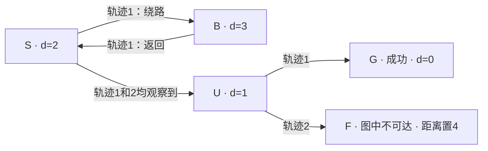

# GraphGPO：把已有轨迹合并成图，再用成功距离重新给动作评分

> 论文：Beyond Trajectory-Level Attribution: Graph-Based Credit Assignment for Agentic Reinforcement Learning，ICML 2026。依据 `GraphGPO.pdf`（arXiv v2），重点核对 §4、§5、附录 A–D；代码：`/usr/data/verl-agent/recipe/GraphGPO`，commit `20bd331bdbc9026a5668e11362178e10ab7400c8`。数值例子为本文构造。

## 1. 先区分 GiGPO 与 GraphGPO

**GiGPO 不进行显式 graph 操作。GraphGPO 才是“轨迹变图 → 反向最短路径 → 图评分 → 同源状态优势”的方法。**

二者都会把同状态出发的动作放在一起比较，真正分界在于动作评分：

- GiGPO：这次动作之后，**该轨迹实际走出的后续**获得了多少回报？
- GraphGPO：这次动作到达的后继状态，利用**整组已观察转移构成的图**，距离成功还有多远？

所以 GraphGPO 并非仅仅把 GiGPO 的 hashmap 换成图数据结构。它利用图改变了监督信号的来源，能够跨轨迹复用可达路径信息。

## 2. Motivation：为什么步骤优势还可能归因错误

GiGPO 的 MC return-to-go 已经是步骤级，但好动作可能出现在失败轨迹中。若后面某个动作犯错，前面正确步骤仍然只有零终局回报；成功轨迹中的绕路又可能被整体成功掩盖。

**step-level 的数值位置，不等于已经隔离当前 action 的贡献。** HGPO 改善历史条件可比性，仍未替换这一实际 continuation 回报。GraphGPO 的新视角是让已采集的转移可以在共享状态处“连接”，从全局结构衡量动作后果。

## 3. graph 具体由什么组成

固定任务 $x$ 和初始环境条件，采样 $N$ 条轨迹，收集有效转移：

$$
\mathcal D_x=\{(s_{i,t},a_{i,t},s_{i,t+1},c_{i,t})\}_{i,t}.
$$

$c_{i,t}>0$ 为转移成本；主实验取 $1$。一条边必须来源于实际采到的转移，不由 LLM 猜测或世界模型生成。

建立有向图 $\mathcal H_x=(\mathcal V_x,\mathcal E_x)$：

- **节点**：匹配为相同的状态合并成一个节点，主代码按 `anchor_obs` 和 `next_obs` 表示。
- **边**：从当前节点指向后继节点，保存动作、轨迹 ID、数据行 ID 等属性。
- **重复边**：实现保留多次出现的转移实例，而非把所有相同动作或相同两端点的数据都去重。
- **终点**：成功结束的后继状态映射为统一 `success` 节点。
- **范围**：每个任务 `uid` 建一张图；不是把不同题的所有状态混成一张全局图。

这是每轮 rollout 数据上的经验图，主流程没有无限增长的跨训练迭代图记忆。

## 4. 从成功节点反向求最短路

对成功节点 $g$ 定义 $d(g)=0$，其他状态距离为：

$$
d(s)=\min_{(s,a,s')\in\mathcal E_x}\bigl[c(s,a)+d(s')\bigr],
$$

如果在本次经验图上没有通向成功的路径，则先令 $d(s)=+\infty$。这个距离是**图中已观察边上的最小剩余成本**，不是环境真实最优距离，也不是当前策略的成功概率。

代码将边反向后，从 `success` 运行一次 Dijkstra，得到所有节点到成功的距离。主实验边权全为 $1$，理论上也可以用反向 BFS；当前实现仍用优先队列求最短路。

为避免无穷距离造成过强的区分，论文将不可达节点的距离改为：

$$
\bar d(s)=
\begin{cases}
d(s),&d(s)<+\infty,\\
d_{\max}+1,&d(s)=+\infty,
\end{cases}
\qquad
 d_{\max}=\max_{v:d(v)<+\infty}d(v).
$$

这里的“不可达”只表示**当前图中没有观察到成功通路**；不能推断真实环境中永远不可达。

## 5. 从图距离得到动作分数与优势

### 5.1 图评分

论文 Eq. (4) 定义：

$$
R^G(s,a,s')=r_{\rm succ}\,\omega^{\bar d(s')+c(s,a)},\qquad 0<\omega<1.
$$

$r_{\rm succ}$ 是成功奖励尺度，$\omega$ 是距离折扣。评分取决于执行当前 action 的成本以及从后继状态走到成功的最短剩余成本。越接近成功，评分越高。

它可以被称为 graph-based step reward，但不是环境新标注的过程 reward，也不是从该步骤往后实际观测到的 return。它是根据经验图构造的代理评分。

尤其不要把主公式直接写成 $d(s)-d(s')$：论文的主公式是距离的指数映射。对固定起点 $s$ 来说，比较下一状态距离与比较“离目标进步多少”在排序上相容，但表达式并不相同。

### 5.2 同源节点分组

$$
\mathcal G_x(s)=\{e=(s,a,s'):\ e\text{ 是从 }s\text{ 发出的已采样转移实例}\}.
$$

此时分组方式与 GiGPO 的锚点分组相近：按起点状态比较候选动作，而非按终点或 action 文本相同来分组。

$$
A_e^G=
\frac{R_e^G-\operatorname{mean}_{e'\in\mathcal G_x(s)}R_{e'}^G}
{\operatorname{std}_{e'\in\mathcal G_x(s)}R_{e'}^G+\varepsilon}.
$$

同组标准化把图评分转成相对优势；单例组或等分数组缺少相对区分。实现同时支持只减均值的模式。

### 5.3 保留整轨迹信号

$$
A_{i,t}=\beta_G A_{i,t}^G+\beta_E A_i^E.
$$

$A_i^E$ 是整轨迹相对优势，两项权重在论文主实验均为 $1$。整体项可为没有可比较出边的状态提供学习信号。之后使用与 GRPO/GiGPO 同类的 clipped policy objective，并把该步优势广播到该步有效 response token。

**失败轨迹中的某一步得到正的图优势，不保证加上负的 episode advantage 后总优势仍为正。** 这是理解“挽救失败轨迹中的好动作”时必须保留的条件。

## 6. 同一例子完整演算：GiGPO 和 GraphGPO 的分界

设只在成功终点给 $1$，普通 MC 折扣和图折扣均为 $0.9$：

```text
轨迹 1：S → B → S → U → G（成功）
轨迹 2：S → U → F        （失败）
```

### 6.1 原始两条轨迹合成一张图



图中用一条 `S→U` 箭头表示两次观察，实际样本表仍保留两行。原先成功轨迹走了 `S→B→S→U→G`，但图上的最短路径是 `S→U→G`，长度为 $2$。

### 6.2 反向传播距离

从 $G$ 出发，反向处理入边，依次得到：

$$
d(G)=0,\quad d(U)=1,\quad d(S)=2,\quad d(B)=3.
$$

$F$ 没有已观察到的成功通路，有限最大距离为 $3$，所以置 $\bar d(F)=4$。Dijkstra 是在固定图上运算，没有因此生成新的 LLM token，也没有把拼出的路径重新交给环境执行。

### 6.3 比较从 S 发出的三次动作实例

| 动作实例 | GiGPO 的实际后续回报 | GraphGPO 的图评分（论文式） |
|---|---:|---:|
| 轨迹 1 的 S → B | $0.9^3=0.729$ | $0.9^{3+1}=0.6561$ |
| 轨迹 1 的 S → U | $0.9=0.9$ | $0.9^{1+1}=0.81$ |
| 轨迹 2 的 S → U | $0$ | $0.9^{1+1}=0.81$ |

区别集中在最后一行：轨迹 2 后来在 $U$ 选择了失败分支，但图中存在由轨迹 1 提供的 `U→G`，所以 `S→U` 的图评分不再被这次失败 continuation 绑死。

使用总体标准差演示：

$$
A_S^{\mathrm{GiGPO,step}}\approx(0.477,0.915,-1.391),
\qquad
A_S^{\mathrm{GraphGPO,graph}}\approx(-1.414,0.707,0.707).
$$

以上只比较局部分量。若按每轨迹等权且总体标准差算 episode advantage，两条轨迹分别为 $+1,-1$，轨迹 2 的首步总优势仍为 $-1+0.707=-0.293$。GraphGPO 在这里减轻了惩罚，却没有把最终方向保证翻成正向。

### 6.4 为什么说是“拼接可达性”，而不是“拼接新训练轨迹”

图允许在共享状态处使用其他轨迹观察到的后续通路，重新计算分数。但更新对象仍是实际采样输出及其真实 prompt。不会凭空创造一段新 response，再假装它是由 old policy 在另一个 prompt 下采到的样本。

## 7. 伪代码与实际代码入口

```text
for 每个训练任务组 x:
    收集 N 条真实轨迹
    将当前/后继状态转成匹配 key
    建有向多重图，成功终点映射为 success
    反向 Dijkstra：求所有节点到 success 的距离
    将无穷距离置为最大有限距离 + 1
    对每条已采样边计算 graph score
    按边的起点状态分组，中心化/标准化 score
    加入 episode advantage
    将对应优势交给实际采样的 response token 更新
```

| 代码位置 | 核对内容 |
|---|---|
| [core_graph.py](./GraphGPO/recipe/GraphGPO/core_graph.py)：`ComplexGraph.from_data` | 按 `uid` 建图，保存 `data_id/traj_uid/action`，主成本固定 1 |
| 同文件：`all_to_target_shortest_paths` | 反向 Dijkstra；不可达距离置为 `far_distance+1` |
| 同文件：`compute_graph_path_returns` | 从距离计算每个采样步骤的评分 |
| 同文件：`compute_graphgpo_outcome_advantage` | 复用 GiGPO 的同状态分组与归一化，再组合两级优势 |
| [graphgpo_ray_trainer.py](./GraphGPO/recipe/GraphGPO/graphgpo_ray_trainer.py) | `fit` 中建图、算距离并选择图评分分支 |

### 7.1 论文与代码的评分差别

默认 `normalize_distance=False` 的代码为：

$$
R_{\rm code}^G=10\gamma^{\bar d(s')+c-1}.
$$

主代码 $c=1$，即 $10\gamma^{\bar d(s')}$。它相对论文式存在成功奖励尺度和指数减一的差别。当 $r_{\rm succ}=10$、$\omega=\gamma$ 时，两式相差共同正因子 $1/\gamma$；组内除标准差会基本消去该尺度（数值 $\varepsilon$ 除外），只减均值则保留尺度差异。

代码还有可选 `normalize_distance=True` 分支：

$$
R_{\rm code,norm}^G=10\gamma^{\bar d(s')-\bar d(s)+c}.
$$

这是实现选项，不应混写成论文的主公式。代码中当前边成本硬编码为 $1$，不代表论文提出的任意正成本接口已完整参数化。

## 8. 为什么可能有效，以及理论的条件

同一条转移在不同 trajectory 中出现时，GiGPO 的 MC 评分可因后续成败不同而改变。固定经验图后，GraphGPO 为相同转移生成一致的图分数，削弱了具体 continuation 带来的噪声，也能识别一些成功轨迹中的绕路。

论文 Proposition 4.1 的排序结论直接来自：

$$
c(s,a_1)+d(s'_1)<c(s,a_2)+d(s'_2)
\ \Rightarrow\ R^G(s,a_1,s'_1)>R^G(s,a_2,s'_2).
$$

因为 $0<\omega<1$，指数较小则分数较大；同组减去相同均值并除以相同正标准差，保留排序。

Proposition 4.2 的低条件方差解释需要谨慎：**固定经验图之后**，图分数对给定转移是确定的；但即使环境转移确定，随机策略采出的经验图仍然会随 batch 改变。因此不能把这个论证扩展为“跨 batch 的图评分方差为零”或“梯度方差必定更小”。

## 9. 实验与证据

论文主要任务是 ALFWorld、WebShop、Sokoban；组大小均为 $8$，主比较不为每状态额外采样。

在其自身 Table 1，1.5B 模型 WebShop 成功率：GRPO 71.35、GiGPO 73.83、GraphGPO 78.65；Table 2 的 Sokoban：GiGPO 76.92、GraphGPO 86.98。它们是该文设置下的比较，不能与其他论文的同名方法数值直接拼成排名。

去掉 episode 分量通常会降低性能，支持保留整体项的设计。动态采样（全成/全败组重新采样）是额外消融组件，会增加采样尝试，不能把 `+DS` 结果也说成无额外 rollout。

图构建与最短路只作用于已有数据，相对 LLM rollout 成本较小。但它仍有 CPU、图存储和搜索成本，不能说“完全零开销”。

## 10. 最重要的边界

- **无成功锚点**：若该任务组没有任何通向成功节点的观察边，单靠图无法发现未知成功路径。主代码在单位成本下会让这些节点的距离与图评分退化为同一值，局部优势为零。
- **状态匹配可靠性**：视觉或文本相似不等于相同 Markov 状态。错误合并可制造不可执行的“捷径”。
- **历史依赖**：图距离通常按环境状态求，未同时做到 HGPO 式完整上下文条件化。
- **随机性**：最短路偏向已观察到的最好通路；在随机转移或高风险动作下，不能替代期望回报估计。
- **策略可执行性**：图存在路径，不表示当前策略会以高概率选择其中所有动作。
- **不是一般不变性 reward shaping 证明**：其主评分不是标准的 $\gamma\Phi(s')-\Phi(s)$ 势函数差，不能直接套用保持最优策略不变的结论。

## 11. 真正贡献

GiGPO 回收的是“相同状态下可以比较哪些动作”；GraphGPO 进一步回收的是“跨轨迹转移连接起来后，能够提供什么新的动作评分”。它把**已有数据中的可达结构**变成信用分配信息，而不是简单把 trajectory advantage 改名为 step reward。

继续阅读：[GiGPO](../NeurIPS2025-GiGPO/analysis.md) · [HGPO](../ICLR2026-HGPO/analysis.md) · [时间线与统一数学对照](../../01-GRPO到GraphGPO与DrMAS-时间线与分组优势对比.md)。
